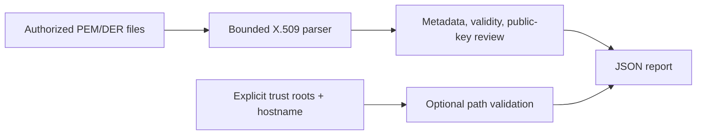

# Architecture and threat model

The CLI reads explicitly provided local certificate paths. Each input is bounded, checked for private-key markers, and parsed by `cryptography`. Metadata and hashes become a JSON report. Optional chain validation receives a user-supplied root set and DNS hostname. No system trust store or network connection is used.

Threats include accidental private-key disclosure, malformed ASN.1, misleading self-signed trust claims, and false assumptions about deployed TLS. Controls include single-certificate PEM validation, input size caps, no private-key serialization, explicit roots and hostname, and a `not_checked` trust default. The analyzer does not infer endpoint reachability or CT status.
